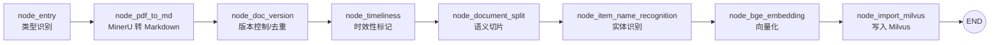
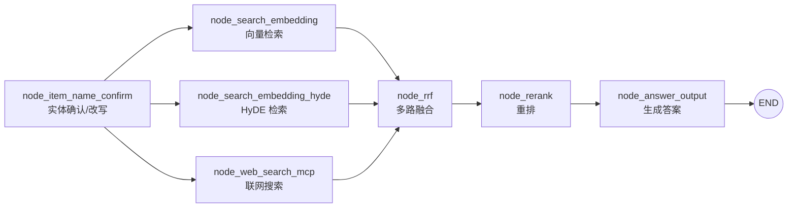

<div align="center">

# 智汇智库 · 企业设备知识库 RAG 系统

**基于 LangGraph + Milvus + MinerU 的企业级检索增强生成（RAG）知识库**

多类型文档导入 · 版本可控 · 时效可管 · 质量可监控 · 反馈可闭环

</div>

---

## 📖 项目简介

智汇智库是一套面向**企业设备知识库**场景的 RAG 系统，覆盖「文档导入 → 切片向量化 → 混合检索 → 重排 → 答案生成」全链路，并在工程上补齐了实际生产中容易缺失的三块能力：

- **可追溯**：文档有版本、可去重、历史可归档；
- **可时效**：内容有生效/失效时间，过期内容默认不参与召回；
- **可治理**：检索质量可量化、可反馈、可诊断，并输出 dry-run 治理建议。

系统对外提供两个独立服务：**导入服务（:8000）** 与 **查询服务（:8001）**，各自附带可视化页面。

---

## ✨ 核心特性

| 特性 | 说明 |
|------|------|
| 🗂️ **多类型文档导入** | 支持 PDF、Markdown、图片（png/jpg/jpeg/jp2/webp/gif/bmp）与 Office 文档（doc/docx/ppt/pptx/xls/xlsx），统一经 **MinerU API** 转为 Markdown；单文件上限 **200MB / 200 页** |
| 🔢 **文档版本控制** | 以 `doc_id` 归一 + `content_hash` 去重 + `version`/`is_latest` 维护版本链，切片仅保留最新版，历史版本归档至 MinIO |
| ⏰ **文档时效性标记** | 记录 `publish_date`/`expire_date`/`timeliness_status`/`source_dept`；查询期对过期与未生效内容**硬过滤**，重排期做**半衰期软降权**，答案中追加时效提示 |
| 📈 **检索质量监控** | 以无侵入 Hook 记录每次检索的 TopK、来源、延迟、答案，并在监控页展示汇总指标 |
| 🔁 **反馈闭环** | 支持人工标注「答案正确 / 有误 + 备注」，按主题聚合准确率与趋势，自动诊断「文档过时 / 重复过多 / 覆盖不足」 |
| 🧭 **治理报告（dry-run）** | 命令行生成知识库治理建议报告，**默认只读、不自动修改生产数据** |
| 🔍 **混合检索** | 稠密向量检索 + HyDE + 联网搜索多路召回，RRF 融合后经 BGE Reranker 重排 |
| 💬 **流式问答** | 基于 SSE 的流式答案输出，前端展示处理阶段进度 |

---

## 🧱 技术栈

| 层次 | 选型 |
|------|------|
| 语言 / 包管理 | Python ≥ 3.11，[uv](https://github.com/astral-sh/uv) |
| Web 框架 | FastAPI + Uvicorn |
| 编排引擎 | LangGraph（导入图 / 查询图） |
| 向量数据库 | Milvus 2.4.11 |
| 文档数据库 | MongoDB（版本注册表、会话历史、检索日志/反馈） |
| 对象存储 | MinIO（历史版本归档、图片资源） |
| 文档解析 | MinerU API |
| 向量模型 | BGE-M3（`BAAI/bge-m3`） |
| 重排模型 | BGE Reranker Large（`BAAI/bge-reranker-large`） |
| 大模型 | OpenAI 兼容接口（默认对接 DeepSeek） |

---

## 🏗️ 系统架构

### 文档导入流程



### 检索问答流程



---

## 📂 目录结构

```
demo_rag/
├── app/
│   ├── conf/                 # 各配置类（dataclass 单例，读取 .env）
│   ├── core/                 # 日志等基础设施
│   ├── clients/              # Milvus / MongoDB / MinIO 客户端封装
│   ├── lm/                   # 向量 embedding、reranker 模型封装
│   ├── utils/                # 通用工具（任务状态、SSE、度量、文档元数据等）
│   ├── import_process/       # 导入链路：agent 图 / nodes / api / page
│   │   ├── agent/            # LangGraph 导入图与节点
│   │   ├── api/              # 导入服务 FastAPI 入口
│   │   └── page/             # 导入页面 HTML
│   ├── query_process/        # 查询链路：agent 图 / nodes / api / page
│   │   ├── agent/            # LangGraph 查询图、节点、状态、质量 Hook
│   │   ├── api/              # 查询服务 FastAPI 入口
│   │   └── page/             # 问答页 / 监控页 HTML
│   └── tool/                 # 运维工具（治理报告、迁移脚本、模型下载）
├── prompts/                  # 提示词文件
├── docker-compose.yml        # Milvus / etcd / MinIO / Attu
├── pyproject.toml / uv.lock  # 依赖声明与锁文件
└── .env                      # 本地环境变量（不入库）
```

---

## 🚀 快速开始

### 1. 启动基础设施

```bash
docker compose up -d       # 启动 etcd / MinIO / Milvus(standalone) / Attu
```

暴露端口：

| 服务 | 端口 |
|------|------|
| Milvus | `19530`（gRPC）/ `9091`（健康检查） |
| MinIO | `9002`（API）/ `9003`（控制台） |
| Attu（Milvus GUI） | `8000` ⚠️ 与导入服务端口冲突，可不用或改宿主端口 |

> MongoDB 需自行准备（本地或容器），并在 `.env` 中填写连接串。

### 2. 配置环境变量

在项目根目录创建 `.env`（**该文件已被 `.gitignore` 排除，请勿提交**），示例：

```dotenv
# ---- LLM（OpenAI 兼容接口，可对接 DeepSeek）----
OPENAI_BASE_URL=
OPENAI_API_KEY=
LLM_DEFAULT_MODEL=deepseek-chat
LLM_DEFAULT_TEMPERATURE=0.1
VL_MODEL=

# ---- 向量 / 重排模型 ----
BGE_M3_PATH=          # 本地模型路径，留空则使用 BAAI/bge-m3
BGE_M3=
BGE_DEVICE=cpu
BGE_FP16=0
BGE_RERANKER_LARGE=   # 本地模型路径
BGE_RERANKER_DEVICE=cpu
BGE_RERANKER_FP16=0

# ---- Milvus ----
MILVUS_URL=http://127.0.0.1:19530
CHUNKS_COLLECTION=kb_chunks
ITEM_NAME_COLLECTION=
ENTITY_NAME_COLLECTION=

# ---- MongoDB ----
MONGO_URL=mongodb://127.0.0.1:27017
MONGO_DB_NAME=

# ---- MinIO ----
MINIO_ENDPOINT=127.0.0.1:9002
MINIO_ACCESS_KEY=
MINIO_SECRET_KEY=
MINIO_BUCKET_NAME=
MINIO_IMG_DIR=
MINIO_SECURE=False

# ---- MinerU 文档解析 ----
MINERU_BASE_URL=
MINERU_API_TOKEN=
MINERU_MAX_FILE_SIZE_MB=200
MINERU_MAX_PAGES=200
```

> 模型首次运行会自动下载（`BAAI/bge-m3` / `BAAI/bge-reranker-large`），也可用 `app/tool/download_bgem3.py`、`app/tool/download_reranker.py` 预先下载到本地。

### 3. 启动服务

```bash
# 导入服务（:8000）
uv run python app/import_process/api/import_server.py

# 查询服务（:8001）
uv run python app/query_process/api/query_server.py
```

页面入口：

- 导入页：<http://127.0.0.1:8000/import>
- 问答页：<http://127.0.0.1:8001/chat.html>
- 质量监控页：<http://127.0.0.1:8001/monitor.html>

---

## 🔌 接口一览

### 导入服务（:8000）

| 方法 | 路径 | 说明 |
|------|------|------|
| GET | `/import` | 文件导入页面 |
| POST | `/upload` | 上传文件（支持多类型）并启动导入图 |
| GET | `/status/{task_id}` | 查询导入任务进度 |

### 查询服务（:8001）

| 方法 | 路径 | 说明 |
|------|------|------|
| GET | `/health` | 健康检查 |
| GET | `/chat.html` | 问答页面 |
| GET | `/monitor.html` | 检索质量监控页面 |
| POST | `/query` | 发起提问（同步 / 异步流式） |
| GET | `/stream/{session_id}` | SSE 流式结果 |
| GET | `/history/{session_id}` | 查询历史对话 |
| DELETE | `/history/{session_id}` | 清空历史对话 |
| GET | `/query/monitor/recent` | 最近检索日志与汇总指标 |
| GET | `/query/monitor/{session_id}` | 某会话检索详情（含 TopK、反馈） |
| POST | `/query/feedback` | 提交「答案是否正确」人工反馈 |
| GET | `/monitor/diagnose` | 按时间窗口输出治理诊断 |

---

## ⚙️ 关键配置开关

系统对影响检索行为的能力提供了开关，便于灰度与回滚：

| 变量 | 默认 | 作用 |
|------|------|------|
| `VERSION_ENABLED` | `true` | 启用文档版本控制 |
| `TIMELINESS_ENABLED` | `true` | 启用时效性标记与处理 |
| `EFFECTIVE_DATE_FILTER_ENABLED` | `true` | 过滤尚未生效（`publish_date > now`）的内容 |
| `TIMELINESS_EXPIRED_POLICY` | `exclude` | 过期内容策略（排除 / 降权） |
| `TIMELINESS_HALF_LIFE_DAYS` | `365` | 半衰期软降权天数 |
| `TIMELINESS_MIN_FACTOR` | `0.6` | 降权因子下限 |
| `MONITOR_ENABLED` | `true` | 启用检索质量监控 |
| `MONITOR_WINDOW_DAYS` | `14` | 治理诊断统计窗口（天） |

---

## 📊 质量治理

- **监控看板**：监控页汇总总检索数、反馈数、准确率、主题数、平均 TopK 等指标；
- **反馈闭环**：对每次检索标注「答案正确 / 有误 + 备注」，累计为主题级准确率与趋势；
- **治理诊断**：`GET /monitor/diagnose?days=14` 输出各主题诊断结论与建议；
- **治理报告**：命令行生成 Markdown 报告（**dry-run，不改动生产数据**）：

```bash
uv run python -m app.tool.kb_governance_report --days 14 --out docs/治理报告.md
```

---

## 🗄️ 数据存储

| 存储 | 用途 |
|------|------|
| Milvus | 切片向量与标量字段（`item_name`、`doc_id`、`version`、`is_latest`、`publish_date`、`expire_date`、`timeliness_status`、`source_dept` 等） |
| MongoDB | 文档版本注册表、会话历史、检索日志（`retrieval_logs`）、人工反馈（`retrieval_feedback`） |
| MinIO | 历史版本切片归档、答案引用的图片资源 |

---

## ⚠️ 已知前置条件

- **Milvus 集合需与代码字段对齐**：若使用早期版本的集合，请先执行迁移脚本（`app/tool/migrate_kb_versions.py`）重建集合并重导历史数据，否则版本/时效相关过滤会排除全部历史数据；
- **导入服务端口与 Attu 冲突**：Attu 默认占用宿主 `8000`，如同时使用请调整端口；
- **MinerU 请求**：上传/轮询依赖 MinerU 服务，请确保 `MINERU_BASE_URL` 与 `MINERU_API_TOKEN` 可用。

---

## 📄 说明

本项目为个人 RAG 工程实践项目，仓库内**不包含** `.env` 配置、`doc/` 原始文档、`docs/` 内部报告与日志文件。
